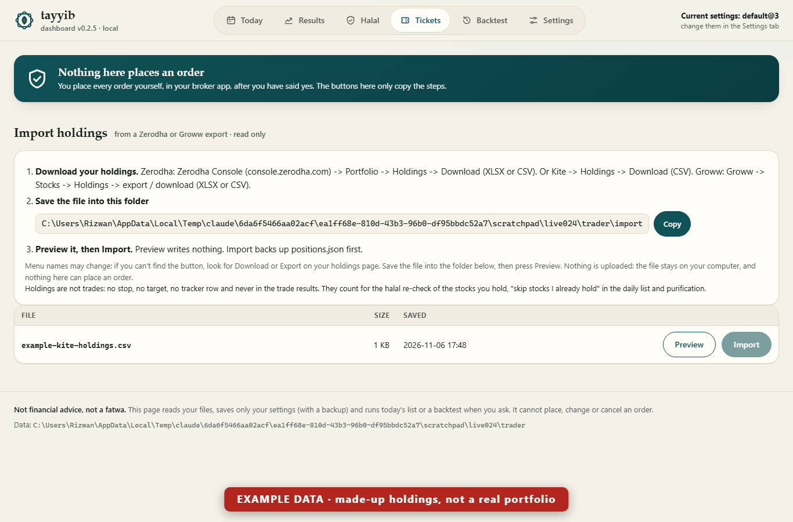
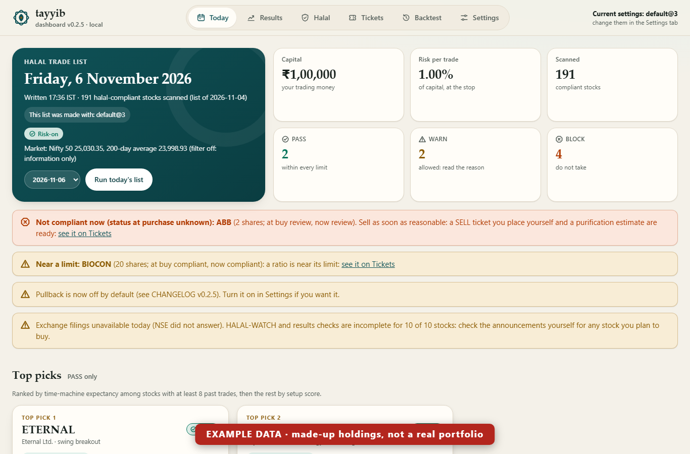
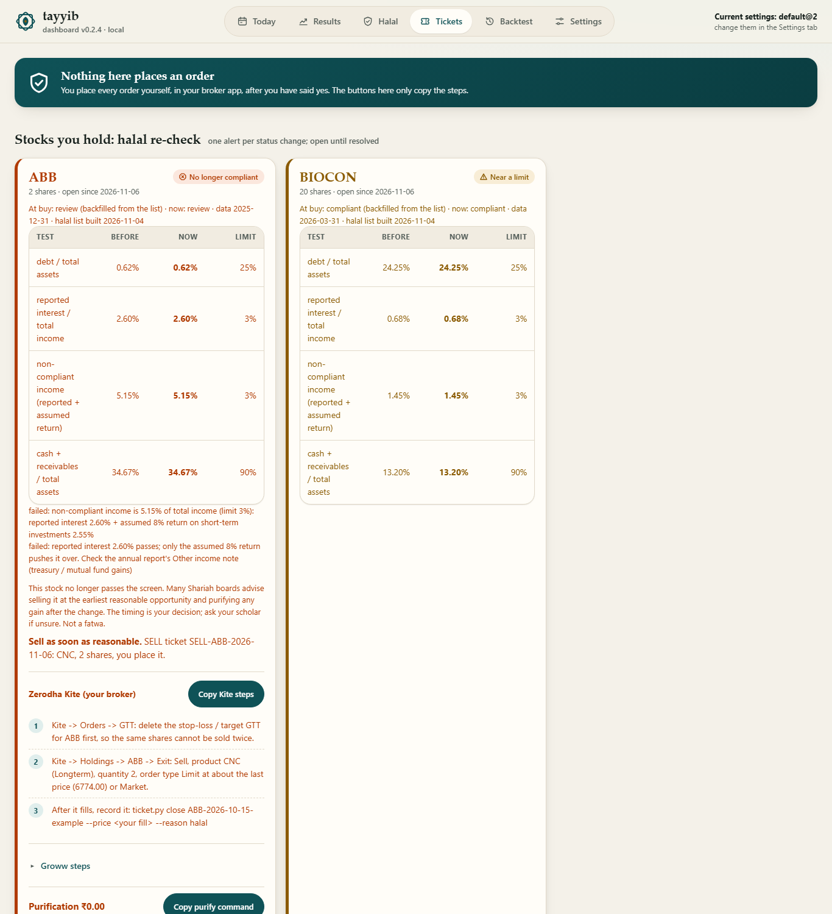
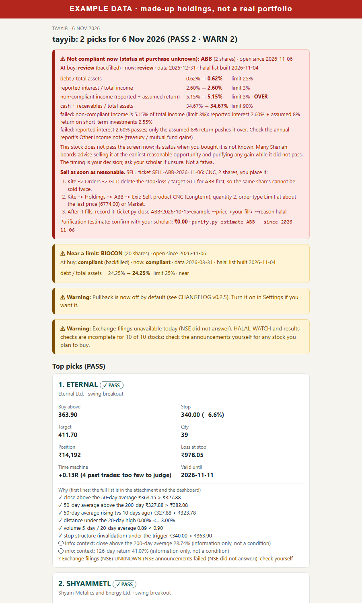

# User guide (no coding needed)

This guide takes you from nothing to your first daily halal list, then shows the routine. There are two
equal ways to use it on Windows: with **Claude Code** (you ask in plain words), or **without Claude Code**
(double-click `start.bat` and use the dashboard). Mac and Linux are the same, with `start.sh` in place of
`start.bat` and `python3` in place of `py` (see [Mac and Linux](#mac-and-linux)).

Nothing in this tool can place an order. You always place it yourself, after you decide.

---

## Part 1: One-time setup (about 20 minutes)

Choose one way: **Option A, with Claude Code** (steps 1 to 6 below) or **Option B, without Claude Code**
(further down). You can switch later: both use the same data folder.

### Option A: with Claude Code

### 1. Install Python
1. Go to https://www.python.org/downloads/ and download Python 3 (any 3.8 or newer).
2. Run the installer. On its first screen, at the bottom, tick **"Add python.exe to PATH"**, then click
   **Install Now**. This also installs the **py launcher**, the `py` command this guide uses (the other box,
   "Use admin privileges when installing py.exe", can stay as it is). Older installers say "Add Python 3.x to
   PATH" and "Install launcher for all users": tick both.
3. Open **Command Prompt** (Start menu, type `cmd`, Enter) and type `py --version`. You should see
   `Python 3.x.x`. If it says `'py' is not recognized`, run the installer again, choose **Modify**, and tick
   **py launcher**.

### 2. Install Claude Code
Follow https://claude.com/claude-code and sign in with your Claude account.

### 3. Make a folder for your trading data
In Command Prompt:
```
mkdir %USERPROFILE%\tayyib-live
cd %USERPROFILE%\tayyib-live
claude
```
Everything the tool saves (your halal list, plans, journal) stays in this folder on your computer.

### 4. Add the tool to Claude Code
Inside Claude Code, type these two lines (one at a time):
```
/plugin marketplace add R12Wan-Pat3l/tayyib-trader
/plugin install tayyib-trader@tayyib-trader
```
Then close and reopen Claude Code (in the same folder).

### 5. Set your own numbers
Ask Claude: **"Create my tayyib config: capital 1,00,000, risk 1% per trade, broker Zerodha"**
(use your real numbers, and Groww if that's your broker).

The important settings:
| setting | default | meaning |
|---|---|---|
| capital | 1,00,000 | money set aside for trading |
| risk per trade | 1% | the most you lose on one trade (Rs 1,000 on 1 lakh) |
| max position | 20% | the most you put in one stock |
| max open positions | 6 | how many trades at once |
| broker | zerodha | `zerodha` or `groww` (sets the charges) |

### 6. Build your halal list (first time only)
Ask: **"Build my halal stock list"**. It checks about 500 companies and takes about 5 minutes.
After this, the daily list refreshes it automatically every 30 days.

### Option B: Start without Claude Code
You need no Claude account and no command typing for the daily routine: everything is in the dashboard.
On a Mac or Linux, see [Mac and Linux](#mac-and-linux) below.

**B1. Install Python** as in [step 1](#1-install-python) above (tick **"Add python.exe to PATH"**).

**B2. Get the tool into `C:\tayyib-trader`.** Either way works:
- **With git** (if you have it), in Command Prompt:
  ```
  git clone https://github.com/R12Wan-Pat3l/tayyib-trader.git C:\tayyib-trader
  ```
- **Without git:** on the [GitHub page](https://github.com/R12Wan-Pat3l/tayyib-trader) click the green
  **Code** button, then **Download ZIP**. In your Downloads folder, right-click `tayyib-trader-main.zip`,
  **Extract All...**, **Extract**. It makes a folder called **`tayyib-trader-main`**, and Windows often puts a
  second `tayyib-trader-main` folder inside the first. Open them until you see `start.bat`, go up one level,
  and move **that** folder (the one that holds `start.bat`) to `C:\`, then rename it to **`tayyib-trader`**.

**Check:** open `C:\tayyib-trader` in File Explorer. You should see `start.bat`, `start.sh`, `README.md`,
`docs`, `core`, `mcp`, `tools` and folders named `tayyib-daily`, `tayyib-dashboard` and so on. If you see only
one folder called `tayyib-trader-main`, it is one level too deep: move the inside one up. The tool's path
must be `C:\tayyib-trader\start.bat`.

**B3. Double-click `start.bat`** in `C:\tayyib-trader`. A black window opens. It:
- finds Python (`py`); if it can't, it says how to install it;
- uses your data folder `%USERPROFILE%\tayyib-live\trader` (or the one in `TAYYIB_DIR`, if you set one), and
  creates it the first time;
- opens the dashboard in your browser at `http://127.0.0.1:8765/`. **Keep the black window open** while you
  use it; close it to stop. (If the browser doesn't open by itself, type that address into it.)

If Windows shows "Windows protected your PC" or "Do you want to run this file?" (it can for a file from a
downloaded ZIP), choose **More info**, **Run anyway** / **Run**. `start.bat` is about 20 lines of plain text: you can
open it in Notepad first and read what it does.

**B4. The Welcome screen.** The very first time (no `config.json` yet) the dashboard opens a **Welcome**
screen: your capital, your broker (Zerodha or Groww), your risk per trade (0.5%, 1%, 1.5% or 2%) and, if you
want, your email address. Press **Save settings** (even if you kept the suggested numbers): it says **Saved ✓**
and your settings code (`default@5` if you kept the defaults). It saves them the same safe way as the Settings
tab. There is no password field on purpose (see Part 3). **Not now** closes it; it comes back next time until
you save.

**B5. Your first list.** After 3:30 PM IST on a trading day (or any time at the weekend: it then uses
the last closing prices available), on the Today tab press **Run today's list**. A panel opens with a **Skip news** box:
leave it unticked and press **Run today's list** in the panel. The first run also **builds your halal list**
(it checks about 500 companies): the panel's first line is "Rebuilding the halal list (first run): about 5
minutes...", and the whole first run takes about 6 to 10 minutes. You can close the panel; the run goes on.
After that the halal list refreshes itself every 30 days. When it finishes, the panel says "Today's list
(DATE) is ready": press **Show today's list**.

If the panel says **FAILED** with "could not build the halal list ... Could not get the Nifty 500 list", the
download of the list of companies was refused: see the first rows of
[Something not working?](#something-not-working). Nothing was changed: fix it and press **Run today's list**
again. A yellow "Exchange filings unavailable today (NSE did not answer)" banner on the list is normal: NSE
usually refuses automated access, and the list says which checks that affects.

**B6.** Every trading day after 3:30 PM: double-click `start.bat`, press **Run today's list**, read it, and
place any order yourself in Kite or Groww (the Tickets tab has the steps). Part 2 below shows the rest.

**Updates.** Once a month: with git, `git -C C:\tayyib-trader pull`; without git, download the ZIP again and
replace the `C:\tayyib-trader` folder. Your data is in `%USERPROFILE%\tayyib-live`, not in the tool's folder, so
an update never touches it.

### Mac and Linux
The same as Option B, with `start.sh` in place of `start.bat` and `python3` in place of `py`:
1. Install Python 3.8 or newer (Mac: from python.org or `brew install python`; Linux: usually already there,
   check with `python3 --version`).
2. Get the tool: `git clone https://github.com/R12Wan-Pat3l/tayyib-trader.git ~/tayyib-trader` (or the ZIP,
   unzipped and renamed to `~/tayyib-trader`).
3. In Terminal: `~/tayyib-trader/start.sh`. It uses `~/tayyib-live/trader` (or `TAYYIB_DIR`), creates it,
   and opens the dashboard. Keep Terminal open; Ctrl+C stops it. If it says "permission denied", run
   `sh ~/tayyib-trader/start.sh` instead.
4. Welcome screen, then **Run today's list**, as in B4 and B5.

Commands elsewhere in this guide are written for Windows: on Mac and Linux use `python3`, `/` instead of `\`,
`~/tayyib-live` for `%USERPROFILE%\tayyib-live`, and `export TAYYIB_DIR=...` for `set TAYYIB_DIR=...`.

---

## Part 2: Every trading day (about 5 minutes)

1. **After 3:30 PM**, make today's list: in Claude Code (opened in your `tayyib-live` folder) ask
   **"Give me today's halal list"**, or without Claude Code double-click `start.bat` and press **Run today's
   list**.
2. Read the **top picks** and the table. Read every WARN and BLOCK reason.
   - No picks today is normal. Not trading is also a decision.
3. For a stock you like, ask: **"Show me the ticket for SYMBOL"**, or open the dashboard's **Tickets** tab.
   You get the exact Kite or Groww steps.
4. If you decide to take it, **place it yourself** in Kite or Groww:
   - Buy, **CNC** (delivery), order type SL or GTT at the entry price.
   - When it fills, add the **stop-loss and target** (in Kite: GTT, OCO).
5. Record your fill in your journal: tell Claude **"I bought SYMBOL at 1004.50"**, or use the command in the
   table below.

### Without Claude Code: the commands
Everything you would ask Claude has a command. The dashboard covers the list, the tickets, your positions and
your settings; the journal (what you bought and sold), alerts and purification are commands.

**Which data folder a command uses.** Every command reads and writes the folder named in `TAYYIB_DIR`; if that
is not set, it uses a folder called `trader` inside the folder you are in. `start.bat` sets it for you, but a
new Command Prompt window does not. So open Command Prompt and type these two lines first (once per window):
```
cd C:\tayyib-trader
set TAYYIB_DIR=%USERPROFILE%\tayyib-live\trader
```
(Or set it for good with `setx TAYYIB_DIR "%USERPROFILE%\tayyib-live\trader"` and open a new window. Or, instead,
`cd %USERPROFILE%\tayyib-live` and write the full path: `py C:\tayyib-trader\tayyib-broker\ticket.py positions`.)
If you forget, a command run in `C:\tayyib-trader` uses an empty `C:\tayyib-trader\trader` folder and says
`no order/position ...` or shows nothing: set `TAYYIB_DIR` and run it again.

**The ticket ID.** On the dashboard's **Tickets** tab every ticket shows its ID in small grey letters under the
stock name, for example `TATAELXSI-2026-11-06-breakout`; `py tayyib-broker\ticket.py show` prints it too
("TICKET <ID>"). A position keeps its ticket's ID. You can also type the stock's symbol instead of the ID.

| With Claude Code | Without Claude Code (Command Prompt, from `C:\tayyib-trader`, with `TAYYIB_DIR` set or from your `tayyib-live` folder) |
|---|---|
| "Give me today's halal list" | Dashboard: **Run today's list**. Or `py tayyib-daily\daily.py` |
| "Show me the ticket for SYMBOL" | Dashboard: **Tickets** tab. Or `py tayyib-broker\ticket.py show` |
| "I bought SYMBOL at 1004.50" | `py tayyib-broker\ticket.py placed ID --price 1004.50` (add `--qty N` if you bought a different number of shares) |
| "I sold SYMBOL at 1064" | `py tayyib-broker\ticket.py close ID --price 1064` (add `--qty N` for a part sale, `--reason stop`, `target`, `time`, `trail`, `manual` or `halal`) |
| "Raise my stop on SYMBOL to 1020" | `py tayyib-broker\ticket.py stop ID --stop 1020` (a stop can only go up) |
| "Check my alerts" | Once after each buy: `py tayyib-alerts\alerts.py add --from-positions` (the stop, target and time limit of your open positions). Then any time: `py tayyib-alerts\alerts.py check` |
| "Show my positions" | `py tayyib-broker\ticket.py positions` (or the dashboard's **Tickets** tab, at the bottom) |
| "I got a dividend of 240 from SYMBOL" | `py tayyib-purify\purify.py add-dividend SYMBOL 240 --date 2026-08-14` |
| "How much should I purify for 2026?" | `py tayyib-purify\purify.py report --year 2026` (add `--include-gains` to purify gains too) |

Every command has `--help` (for example `py tayyib-broker\ticket.py placed --help`). None of them places an
order: they only write your journal.

### Check how the earlier picks did (the Excel tracker)
Every daily list is recorded automatically and followed on the real prices after that. Open
**`tayyib-live\trader\tracker.xlsx`** in Excel:
- **Tracker** sheet: one row per pick, showing buy above, stop, target, then what happened. The Status
  column is WAITING, NOT TRIGGERED, OPEN, TARGET, STOP, BREAKEVEN or TIME EXIT, followed by the bought
  date, exit date and Result R.
- **Summary** sheet: win rate and average result, split by PASS / WARN / BLOCK, by swing / delivery and by setup.
- The bottom of each daily list also shows "How earlier lists did".

Or ask Claude: **"How did yesterday's picks do?"**. This is paper only: nothing is bought. Judge it after
30 or more closed trades, not after a few days.

### Your paper account and the 15-day report
The Excel tracker follows **every** pick, PASS, WARN and BLOCK, so you can see whether the checks were right.
But you would only buy the PASS picks, and only as many as your money and your settings allow. The **paper
account** copies exactly that, without money:
- only **PASS** picks, from the lists made on or after its start date (10 November 2026, the first list with
  today's settings), in the order the list shows them;
- one position per stock, at most your **max open positions** (6) bought or waiting to buy at once;
- it starts with your **capital** and never spends money it doesn't have; money from a sale can be used from the
  next day (as with a real broker);
- the quantity the list gave, the same buy, stop, target and time rules and the same charges as the tracker.

A PASS pick it could not take is listed as **skipped**, with the reason ("slots full: 6 of 6 open or waiting to
buy", "not enough cash", "already held"). It is compared with simply buying the **Shariah BeES** ETF with the same
money on the start date and holding it.

**Why this is the number to judge before real money:** it is what your account would have done if you had placed
every PASS ticket. The tracker mixes in WARN and BLOCK picks you would not buy, and it doesn't run out of cash or
slots. Wait for **30 or more closed trades** before you judge it: until then the report says "Too early to judge".

**The report.** Every 15 days the daily run writes a short report: **`tayyib-live\trader\reports\DATE.md`** (and a
`.json` copy for programs). If your email is on, it is attached to that day's email. It starts with "Paper only:
nothing was bought.", then the paper account for the last 15 days and since the start, the trades closed, the
positions still open, the skipped picks and why, and at the end the full tracker, for reference only.

Make one any time:

```
py tayyib-tracker\tracker.py report              (the last 15 days)
py tayyib-tracker\tracker.py report --days 30
```

or ask Claude **"make my paper report"**. The dashboard's **Results** tab shows the paper account card at the top
and a list of saved reports; click one to open it.

**How to share it:** open the `.md` file in Notepad, select all, copy and paste it into a chat or an email (it is
short on purpose). It has no passwords, addresses or broker details: only the paper numbers and your capital and
settings. Share it with someone who helps you judge the tool, not as stock tips: sending picks to other people
can count as giving recommendations (see the email section).

### Your dashboard (in the browser)
Everything above, on one page in your browser. It cannot buy or sell anything, and it runs on your own
computer only (nobody else can open it). The only things it can change are your settings (the
Settings tab), today's list (the **Run today's list** button) and your saved backtests (the **Run
backtest** button on the Backtest tab), all explained below.

**Open it on Windows:**
- In Claude Code (in your `tayyib-live` folder), ask: **"Show my dashboard"**. Your browser opens
  `http://127.0.0.1:8765/`.
- Or without Claude: double-click **`start.bat`** in `C:\tayyib-trader` (see
  [Option B](#option-b-start-without-claude-code)), or open Command Prompt, then
  ```
  cd %USERPROFILE%\tayyib-live
  py C:\tayyib-trader\tayyib-dashboard\dashboard.py
  ```
  (use the folder where you cloned or unzipped tayyib-trader). Leave that window open while you use the
  dashboard; press **Ctrl+C** in it to stop. If the port is busy, add `--port 8800` (it works on `start.bat`
  too: see [Something not working?](#something-not-working)).

**What each tab means:**
On a phone the tabs are at the bottom of the screen.
- **Today:** the date and your numbers at the top (capital, risk per trade, how many stocks were scanned,
  how many PASS, WARN and BLOCK). Yellow banners say when the list is old or was made before 3:30 PM, or
  when a news source failed (then HALAL-WATCH and results checks are incomplete). The top picks are
  cards: the bar shows the stop, the buy-above price and the target with how many R each is, and the
  small chart is the last 60 days. Below is the full list: click a column to sort, filter by PASS / WARN /
  BLOCK or swing / delivery, and press **Why?** on any row: a panel opens with every check, ✓ (passed),
  ✗ (failed) or UNKNOWN (no data), and news headlines in full. "stop capped" means the chart's stop was
  further away than your maximum stop %, so the cap was used. "near halal limit" means a ratio is within
  10% under its limit. "This list was made with" shows the settings of that
  list; "Current settings" (top right) shows yours now.
- **Results:** win rate, average R and total R ("no closed trades" until one closes), a ring counting
  closed trades towards 30 (until then: "still noise: don't judge yet"), the equity curve (your running
  total in R), and every earlier pick: TARGET = right, STOP = wrong, NOT TRIGGERED = no trade, TIME EXIT =
  right or wrong by the result, WAITING / OPEN = pending. "Triggered (paper)" is the day the price reached
  the buy-above level on paper: nothing was bought. **Chart** opens the price with the buy, stop and
  target lines. The summary splits results by check, mode, setup and settings.
- **Halal:** a ring of compliant / review / excluded / unknown, then the compliant stocks first (change
  the Status filter to see the rest). Each ratio is a small bar against its limit with the words "within
  limit", "near limit" or "over limit". Press **Ratios** for the details, reported interest next to the
  assumed 8% part, and the reasons. Stocks excluded for their
  business say "not checked (business excluded)": their ratios were never needed. Review and excluded
  stocks are listed for their status only.
- **Tickets:** PASS and WARN tickets you haven't placed yet, with **Copy** buttons for the Kite and Groww
  steps (they say "Copied ✓"), then the blocked ones folded away under "Blocked (not tickets)", then your
  open and closed positions. Copying is the only thing the buttons do: you still place every order yourself.

- **Settings:** change your numbers in the browser. See [Changing your settings](#changing-your-settings).
  The **Email** group sets up the daily email: see [Get the list by email every day](#get-the-list-by-email-every-day).

If a stock's halal status has changed since a list was made, that row only says "halal status changed
since this list: re-check", without prices.

### Run from the dashboard
On the Today tab, press **Run today's list**. It runs the same thing as asking Claude for today's list, on
your computer, with your data folder. You can tick **Skip news** to make it faster (the HALAL-WATCH and
results checks are then not done for today). A panel shows the progress; you can close it and the run
goes on. Only one run at a time.

- Before 3:30 PM IST on a weekday, or on a market holiday in your settings, it asks first: "Prices aren't
  final yet, levels may change". You can still run it.
- When it finishes, the Today tab shows the new list.
- If it fails, the panel shows the error and your old list stays as it was: nothing half-written.
- It never places an order. You still place every order yourself.

If you run it twice on one day with different settings, the tracker keeps the first run's unfilled picks
as **SUPERSEDED** (greyed in Results, "not counted") and follows the new ones. Picks that had already
reached their buy price are never touched.

When a later list shows a stock again, the tracker counts it once:
- if the earlier pick was still waiting for its buy price, the earlier row becomes **REPLACED** and the
  new one is followed (like a new ticket replacing one you never placed);
- if the earlier pick had already been bought (on paper) and not sold, the new row is **ALREADY HELD**:
  a repeat listing is not a second trade.
Both are greyed in Results and the Excel file, kept for the record, and not counted.

### While you hold a trade
- **"Check my alerts"** (`py tayyib-alerts\alerts.py check`): tells you if a stop, target or time limit was hit.
- **"I sold SYMBOL at 1064"** (`py tayyib-broker\ticket.py close ID --price 1064`): records the sale, with
  profit after charges.
- **"Show my positions"** (`py tayyib-broker\ticket.py positions`): your open and closed trades and how you're
  doing.

(Without Claude Code, see [the commands](#without-claude-code-the-commands) for the data-folder rule.)

The **pullback** setup is on by default (v0.2.6; v0.2.5 had switched it off, which made the whole strategy
worse: see "Why one backtest number isn't enough" below). Settings, Strategies, "Pullback (swing)" switches
it off.

### Import your holdings (Zerodha / Groww)
The halal re-check works on the stocks you hold. Trades you record with "I bought X at ..." are already there;
shares you bought before (or outside the tool) can be imported from your broker's holdings file. It only
reads the file: nothing connects to your broker, and nothing is sold or bought.

1. **Download your holdings** (menu names may change; look for Download or Export on your holdings page):
   - Zerodha: Console (console.zerodha.com) -> Portfolio -> Holdings -> Download (XLSX or CSV), or Kite ->
     Holdings -> Download (CSV).
   - Groww: Stocks -> Holdings -> export / download (XLSX or CSV).
2. **Save the file** into `%USERPROFILE%\tayyib-live\trader\import\` (make the folder if it isn't there).
3. **Preview**: on the dashboard's Tickets tab, section **Import holdings**, press **Preview** next to the file
   (or `py tayyib-broker/ticket.py import trader\import\FILE`). You see each holding: quantity, average price,
   the NSE symbol it matched (by ISIN when the file has one), its halal status now and the alert it would get,
   and whether it will be added, updated or left. Rows it cannot match (not on NSE, an SME stock, an ISIN outside
   your halal list) are listed as **could not match**: never dropped, never shown as compliant. For an ISIN you
   know, add `--map ISIN=SYMBOL`.
4. **Import**: press **Import** (only after a Preview of the same file), or add `--yes`. `positions.json` is
   backed up first (`positions.backup-<date-time>.json`).


*Example data: a made-up export file. The Import holdings section on the Tickets tab.*

Holdings are **not trades**: no stop, no target, no tracker row, and they are left out of every result and
backtest. They count for the halal re-check, for "skip stocks I already hold" in the daily list and for
purification. Importing again updates quantities (no duplicates); a holding missing from a newer file is
marked "not in latest import", not deleted; trades from your journal are never changed. If you also recorded a
trade for the same stock, only the extra shares are imported.

Their status when you bought them is not known, so a holding that does not pass now is shown as **"Not
compliant now (status at purchase unknown)"**, not "No longer compliant".

### When a stock you hold stops being halal
Every daily run re-checks the stocks you hold (your open positions) with the same halal screen. A held
stock is screened again when its screen is more than a week old (`halal.held_recheck_days`, 7); the rest
of the list keeps its monthly rebuild.

You get **one alert per change** (not a repeat every day; it stays listed as *open* until it is resolved):

- **No longer compliant** (red): the stock is now excluded or under review. It shows which test failed,
  the ratios when you bought against now, the date of the figures and where they came from. It also gives
  you:
  - a **SELL ticket** for the shares you hold (CNC, the Kite / Groww steps, cancel the stop / target GTT
    first). You place it yourself, when you decide: nothing is ever sold for you;
  - a **purification estimate**: the non-compliant share of the dividends you received while holding it,
    plus any gain since the change (`purify.py estimate SYMBOL --since DATE`). It is an estimate: confirm
    with your scholar.

  "This stock no longer passes the screen. Many Shariah boards advise selling it at the earliest reasonable
  opportunity and purifying any gain after the change. The timing is your decision; ask your scholar if
  unsure. Not a fatwa." `halal.exit_grace_days` (0 = as soon as reasonable) only changes this wording and
  its countdown.
- **Near a limit** (amber): still compliant, but a ratio is close to its limit. Nothing to do yet.
- **Could not verify** (grey): the screen data could not be fetched. It is shown as UNKNOWN with the
  reason: never read as compliant, never as non-compliant. It is tried again on the next run.

The alert is at the top of the daily list, the email and the dashboard (a red banner on Today, a section on
Tickets). When you record the sale ("I sold SYMBOL at 1064", `ticket.py close ... --reason halal`) it is
resolved. To run the check by itself: `py tayyib-halal/halal.py held` (add `--write` to save it).

"No longer compliant" is used only when the stock's status when you bought it is known and was compliant. For
an imported holding, or a trade recorded before v0.2.4 (its status was filled in later from the list), it says
**"Not compliant now (status at purchase unknown)"**.


*Example data: made-up holdings, to show the alerts. The Today banner.*


*Example data: made-up holdings. The Tickets section with the SELL steps and the purification estimate.*


*Example data: made-up holdings. The top of the email.*

### How would this strategy have done? (the backtest)
Ask **"backtest my strategy"** (or run `py tayyib-backtest\backtest.py run --write` from your
`tayyib-live` folder). It runs the daily list on every trading day of the last 3 years with your capital
and settings, as if you had followed it, and takes a few minutes (it downloads 5 years of prices for every
halal stock once a day). It saves `trader\backtest\<id>.md` (read it in any text viewer) and `.json`, and
changes nothing else: not your tracker, tickets, positions or settings.

How to read it:
- **The bold lines at the top come first.** Four are always there: today's halal list is used for the
  past, companies that dropped out are missing (so results are likely better than reality), the past is
  no promise, and news checks can't be replayed. Others may say there were too few trades, that the last
  third of the years was much weaker (possibly overfit), that simply holding the Shariah ETF did better, or
  that the Nifty 50 did better (shown for reference only: it is not halal-screened).
- **Overall**: number of trades, win rate, **expectancy** (the average result per trade, in R after
  charges; above 0 means it made money on average), profit factor (money won / money lost), CAGR (the
  yearly growth rate of your capital), **max drawdown** (the worst fall from a high, with the dates) and
  exposure (how often you had money in a trade).
- **By setup / by mode**: which setups made or lost the money. A column marked "(too few to judge)" has
  fewer than 30 trades: luck can swing it either way.
- **In-sample vs out-of-sample**: the first two thirds of the years next to the last third. If the last
  third is far worse, be careful.
- **Benchmarks**: the same years for the Shariah ETF and the Nifty 50, bought once and held.
- **What happened to the plans**: how many the risk check blocked, and why (too much total risk, already
  two stocks in that industry, reward too small...). It is the same check as the daily list, except news,
  which can't be replayed. WARN plans are taken (as you could take them); `--no-take-warn` takes PASS only.
- **Joined late**: stocks listed during the years tested; they join once they have a year of prices.
- **Skipped stocks**: stocks with no prices, or listed too recently to ever have a year of prices.
- With `--compare` there is one more table: the same years with the stocks ranked by setup score only, so
  you can see how much the time-machine ranking helped.

Options: `--mode swing` or `delivery`, `--years 5`, `--capital 200000`, `--max-positions 4` (without it: your
max open trades, 6 by default), or
`--from 2023-01-01 --to 2025-12-31`, and `--no-late` to leave out stocks listed during those years.
`py tayyib-backtest\backtest.py list` shows your saved runs.

It always ends on the last finished trading day: run it during market hours and it stops at yesterday,
so the numbers don't change while today's prices move. Every result also says how much of the profit came
from stocks listed during those years ("Late joiners: ... % of total P&L"): see the FAQ on why that matters.

### The Backtest tab
In the dashboard, open **Backtest**. What you see, from the top (screenshots:
[light](img/backtest-light.png), [dark](img/backtest-dark.png)):

- **A picker of your saved runs**, newest first (date run, years, mode, trades, CAGR, max drawdown), the
  **Run backtest** button, and a line with the window, your capital, risk per trade, max positions,
  settings label and whether WARN plans were taken.
- **The warnings, before any number**, with an orange triangle: today's halal list used for the past,
  survivorship bias, past results are no promise, news can't be replayed, and any others for this run
  (too few trades, the Nifty did better...). They can't be hidden.
- **Three cards**: the strategy (CAGR, max drawdown, expectancy, trades, win rate), then the Shariah BeES
  and the Nifty 50 (CAGR and max drawdown). The Nifty card has a dashed border and says "not
  halal-screened, reference only".
- **The equity chart**: your capital growing (solid line), the Shariah BeES (dashed) and the Nifty 50
  (dotted), all starting at your capital, with the final value at the end of each line. Under it the
  drawdown strip: how far below its last high the strategy was, with the worst fall's start and bottom
  dates marked.
- **Breakdown**: overall, by swing / delivery, by setup and first two thirds vs last third. Grey rows
  marked "(too few to judge)" have under 30 trades. If the run used compare, a table puts (a) as run,
  (b) ranked by setup score only and (c) without late joiners side by side.
- **Trades**: every trade, sortable, with filters for setup, mode and exit reason. R has its sign (▲ +1.92R,
  ▼ −1.00R). **Chart** opens the trade on its prices: buy level, stop, target, the buy and the exit.
- **Universe**: how many stocks were tested, which joined late (with the date) and which were skipped (and
  why), and the late joiners' share of the profit.

**Run backtest** asks for 3 or 5 years, the mode and compare on or off, then shows its progress (about 4
minutes; compare takes about 3 times longer). You can close the panel: it keeps going, and the new run
appears in the picker when it's done. Only one run at a time (a backtest or today's list): a second press
says so. It writes only your saved backtests and price cache, never your settings, tracker, tickets,
positions or daily lists. Not financial advice, not a fatwa.

### Test on your own stocks
The normal backtest ("All halal stocks") is the honest test of the daily list: it lets the strategy choose
from every compliant stock, as it does each day. Since v0.2.8 there is a second option, **My stocks**: the
same strategy with the same rules (signals, plans, risk check, sizing, charges, your max open trades), but
it may only trade the stocks you pick. It also shows what you would have got by simply **buying and holding
those same stocks**.

**How to pick.** In the dashboard: **Backtest**, **Run backtest**, choose **My stocks**, type part of a
symbol or company name and click the stock. Only compliant stocks on today's halal list can be found and
added (a review or excluded stock is refused, never quietly dropped). Up to 20; each one is a chip you can
remove with ×. **Stocks I hold** does the same with your open trades and imported holdings (it is greyed out,
with the reason, when you hold nothing, or when one of them is not compliant now). Without the dashboard:

```
py tayyib-backtest\backtest.py run --years 5 --symbols TCS,INFY,HCLTECH,RELIANCE,HINDUNILVR,NESTLEIND,BRITANNIA,ASIANPAINT,MARUTI,ULTRACEMCO --write
py tayyib-backtest\backtest.py run --years 5 --holdings --write
```

`--compare`, `--robust 20`, `--robust-compare A B` and `--no-late` work here too, on the same prices.

**The hindsight warning, in plain words.** You are choosing these stocks today, knowing how they have done
since. You will naturally pick names you know, and you know them partly because they did well. Any test on
them will look better than it would have looked to someone choosing five years ago. The result always
carries the line "You chose these stocks today, knowing how they did since. Results are likely better than
reality (hindsight)." Read it as an upper bound, not a forecast.

**Why at least 10 stocks.** The strategy only buys when a stock gives a signal. With 3 stocks it may wait
weeks for one, so there are few trades and one lucky (or unlucky) trade decides the result. Under 10 stocks
the result says "Small basket: fewer stocks means fewer trades and more luck." Under 30 trades on one stock,
its row is greyed and marked "(too few to judge)".

**How to read "strategy vs holding".**
- **The cards** at the top: Strategy, **Buy & hold these stocks** (your capital split equally across the
  stocks, each bought once, with one buy and one sell charge) and the Shariah BeES. If holding did better,
  a line at the top says so: "Buying and holding these same stocks did better."
- **The equity chart** adds the basket's line (the Nifty 50 stays dotted, for reference only).
- **Your stocks** table, above the trades: for each stock, its trades, wins, win rate, total R, P&L, the
  strategy's return on that stock's equal slice of your capital, the return of holding that slice, and
  **better / worse / no trades**. "No trades" means the strategy never bought it. The rows add up to the
  overall result.
- The comparison per stock is rough: the strategy did not keep that slice in that stock all the time. A
  stock in a strong steady uptrend is often better held than traded; the strategy's case is the stocks
  that fell, where it can step aside. See the FAQ: "Why did buying and holding beat the strategy on my stocks?"

The daily list is never changed by this test: it still looks at every compliant stock.

### Market regime filter (optional)
The Today header shows the market's state every day: **Risk-on** when the Nifty 50 closes above its 200-day
average, **Risk-off** when it closes below, with both numbers. With the filter off (the default) this is
information only.

A developer can switch on a filter in `config.json` (`regime.enabled`, an advanced setting): on a risk-off day it can stop new swing trades
(`no_new_swing`), stop all new trades (`no_new_trades`) or halve the risk per trade (`half_risk`). The rule
can also be "the 50-day average is below the 200-day average". The index is only a thermometer, never a
stock to buy. If the index data cannot be fetched, the regime is UNKNOWN, a banner says so, and the filter
does nothing that day.

**Test it before you switch it on.** Ask Claude **"backtest the regime filter for 3 and 5 years"**, or run
`py tayyib-backtest/backtest.py run --years 5 --mode all --regime-compare --write`. The Backtest tab then shows
five columns side by side (off and four variants: trades, win rate, expectancy, CAGR, max drawdown, worst
year, swing and pullback expectancy). Switch it on only if a variant helps on more than one window.

To see whether a variant really helps, rather than by luck on one run:
`py tayyib-backtest/backtest.py run --years 5 --mode all --robust-compare "regime=off" "regime=close_below_200dma:half_risk" --write`.

#### Why one backtest number isn't enough
A backtest gives one number, for example "CAGR 8.0%". That number comes from one run. Small choices that mean
nothing decide part of it: which of two equally good stocks was picked first on a busy day, or whether the test
started on a Monday or a Tuesday. Change one of those and a different trade fills a slot, the next trades
change, and the number moves. If it moves a lot, one run can't tell you whether a change to the strategy helped.

**The pullback story.** In v0.2.5 we turned the pullback setup off because, in a 5-year backtest, its own trades
lost money (46 trades, -0.21R on average). But the whole strategy then did worse: 5-year CAGR 8.0% -> 4.1%,
3-year 7.9% -> 7.0%. Its slots were taken by other trades that did worse still. Looking at one setup's own
number was misleading, so v0.2.6 put pullback back on.

Then we ran the new robustness test on the same 5 years (20 seeds each, 2026-11-06). The single run had been
unlucky in both directions. With pullback on, the median CAGR was 6.2% (8 in 10 runs between 4.5% and 7.6%), so
8.0% was near the top. With pullback off, the median was 7.2% (6.9% to 7.7%), so 4.1% was below every seeded run.
Seed by seed, "off" beat "on" in 15 of 20 runs: 75%, short of the 80% needed. The verdict was "No clear
difference", so the default stays as it has been since v0.1.7 (pullback on). The whole-strategy comparison that
reversed v0.2.5 was itself one lucky and one unlucky run. That is exactly why one number isn't enough.

**What the tool does now.** `--robust` runs the same window 20 times (up to 50) on the same prices. Each run
changes only the meaningless things: the order of signals that rank equal, and the start, moved one trading day.
It also runs max positions 3, 5 and 8. You get a range for CAGR, expectancy, max drawdown and trades (the
middle value and the band where 8 in 10 runs fall), and how often the strategy beat the Shariah ETF.

`--robust-compare "A" "B"` runs both settings with the same seeds and compares them seed by seed:

```
py tayyib-backtest/backtest.py run --years 5 --mode all --robust-compare "pullback=on" "pullback=off" --write
```

- "B is better in X of N runs": B beat A on at least 8 runs in 10.
- "B is worse in X of N runs": B lost on at least 8 in 10.
- Anything in between: "No clear difference: don't change the default on this evidence".

From v0.2.6 on, a default only changes with an 80% verdict like that. The Backtest tab shows each range as a
bar, with the verdict line and a sentence under each bar. It is still a replay of the past with today's halal
list: not a promise, not financial advice.

### Once a month
- The halal list refreshes itself (when it's 30 days old).
- Every few months, compare it with a Shariah fund's holdings: see the [FAQ](FAQ.md#how-do-i-check-the-halal-list-is-right).

### Once a year
- **"How much should I purify for 2026?"** (`py tayyib-purify\purify.py report --year 2026`): the charity
  amount from your dividends. Record each dividend when it arrives ("I got a dividend of 240 from SYMBOL", or
  `py tayyib-purify\purify.py add-dividend SYMBOL 240 --date 2026-08-14`).

---

## Part 3 (optional): Get the list by email every day

### Get the list by email every day
Your computer can make today's list after the close and email it to **your own inbox**, every trading day,
without you running anything. Five steps, once:

1. **Make a Gmail App Password.** In your Google account, open **Security**, switch on **2-Step
   Verification** (needed for app passwords), then open **App passwords**, make one called `tayyib` and copy
   the 16 letters. It is not your normal password, and you can delete it any time to switch the email off.
   (Another mail provider: set `email.smtp_host` and `email.smtp_port` in `config.json`.)
2. **Store it on your computer, not in the tool.** Open a new Command Prompt and type (with your 16 letters):
   ```
   setx TAYYIB_SMTP_PASSWORD "abcdefghijklmnop"
   ```
   Then close that window and **close and reopen `start.bat`** (a running program does not see it). The
   password is never written into `config.json`, never shown and never logged.
3. **Switch it on in `config.json`** (email is an advanced setting since v0.2.7, so it is not on the
   Settings page). Add, with your own address:
   ```
   "email": {"enabled": true, "from": "you@gmail.com"}
   ```
   Leave out `"to"` to send it to yourself (at most 3 addresses, all your own); `"send_when": "picks_only"`
   sends only on days with picks.
4. **Send a test email:** `py tayyib-email\email_report.py test`. A short test arrives in a few seconds; look in Spam the first time.
   If it fails, the exact error from the mail server is shown (a refused login almost always means the App
   Password is missing or mistyped).
5. **Schedule it.** In Command Prompt, from the tool's folder:
   ```
   cd C:\tayyib-trader
   py tools\schedule_windows.py show
   py tools\schedule_windows.py install --yes
   ```
   `show` prints the exact Windows Task Scheduler command and changes nothing. `install --yes` creates one
   task, **tayyib-daily**, that runs at **4:20 PM IST, Monday to Friday**: it makes today's list, then emails
   it. `py tools\schedule_windows.py status` shows it; `remove --yes` deletes it.

**Your PC must be on and you logged in at 4:20 PM.** A sleeping or shut laptop misses that day (Task
Scheduler can "Run whether user is logged on or not": set that yourself in its window if you want).

Screenshots: [the email](img/email-desktop.png), [on a phone](img/email-narrow.png), [a FAILED day](img/email-failed.png).

What the email says, in order: anything wrong first (a failed run, or a stock you hold that is no longer
compliant, in red), every warning of the list, the top PASS picks as cards (buy above, stop, target,
quantity, position, loss at the stop, the time machine, the first lines of Why), the other rows with their
check, your paper tracker, and "Not financial advice, not a fatwa". The full list is attached as a `.md`.
- If the list failed or is not today's, the subject is **"tayyib: run FAILED / data stale"** and it says what
  is missing. It never shows an older day's picks as today's.
- Weekends and the holidays in your settings: no list, no email.
- Without the password the daily list still runs; the email is skipped and `trader\email\log.json` says
  "password not set".
- To look at an email without sending it: `py tayyib-email\email_report.py send --dry-run` writes it to
  `trader\email\` (open the `.html` in your browser).

**Only for you.** Sending the list to other people can count as publishing stock recommendations, which in
India may need SEBI Research Analyst registration. If a friend or your team wants it, each person runs their
own copy on their own computer. See the [FAQ](FAQ.md#can-i-email-the-list-to-my-friends).

On a holiday that is missing from your settings, the list repeats the previous day's prices and the email
may say "data stale". Add NSE holidays to your config (`"holidays": ["YYYY-MM-DD", ...]`, or Settings,
Holidays) so plan dates and the scheduled run skip them.

---

## Changing your settings

Your settings live in `tayyib-live\trader\config.json`. Anything you don't set keeps its default. Since
v0.2.7 there are only a few things to change, and the page shows only those:

| group | what you change | default | allowed |
|---|---|---|---|
| **Money & risk** | capital | ₹1,00,000 | your own amount |
| | risk per trade | 1% | 0.25% to 3% |
| | max in one stock | 20% | 5% to 40% |
| | max open trades | 6 | 1 to 20 |
| **Broker** | Zerodha or Groww | Zerodha | the charges come from the built-in table for your broker |
| **Strategies** | Trend (delivery), Breakout, Pullback, Oversold, Squeeze (swing) | all on | on or off; at least one stays on |
| **Holidays** | NSE trading holidays | none | dates, YYYY-MM-DD |

**In the dashboard (Settings tab).** Move a slider, pick a broker, switch a strategy, add a holiday:
- a changed value is marked **changed**, with **Reset** to go back to the default;
- a value outside its range is marked in red at once, with the reason (switching all five strategies off
  is refused: at least one must stay on);
- on the right (below, on a phone), **What this means in rupees** shows your loss per trade and after 3, 5
  and 10 losses in a row, with a warning above 2% a trade;
- **Review & save** lists every change (old → new) first. Nothing is saved until you press **Save
  settings**. Then it says "Changes apply from the next run."

Every save keeps a copy of your old `config.json` in `trader\config_backups\` (the last 20). Under
**Backups** you can see what each one would change and restore it, the same safe way.

**Back to the defaults.** Each field has **Reset**, each group has **Reset this section**, and the top of
the page has **Reset all to defaults**. "Reset all" keeps your capital and broker (they are facts about
you, not strategy) unless you tick **Also reset capital and broker**. A reset only changes the form:
nothing is saved until you press **Review & save** and confirm, and the old settings are kept as a backup,
so you can undo it from **Backups**.

**Halal is not a setting.** The **Halal** card on the page shows the rules (debt under 25% of total
assets, non-compliant income under 3%, cash + receivables under 90% of assets, an assumed 8% on short-term
investments, and "review" stocks are blocked) with "These rules can't be changed in the app." The
automatic screen decides; there is no per-stock override. See the [FAQ](FAQ.md#can-i-change-the-halal-rules).

The rules that keep it halal and cash-only are shown under **Always on**: they are not settings, and the
page cannot switch them off.

**By asking Claude**, for example: **"set my risk per trade to 0.5%"** or **"turn off the squeeze
strategy"**.

**Risk per trade is not the stop.** They are two different things:
- The **stop** is how far the price may fall before you sell (for example 5% under your buy price).
  The plan sets it from the chart.
- **Risk per trade** is how much *money* you lose if that stop is hit (1% = Rs 1,000 on Rs 1 lakh).
  The tool picks the number of shares so the loss at the stop is that amount.

So a wider stop means *fewer shares*, not a bigger loss. With 1% risk on Rs 1 lakh:
- a 10% stop buys about Rs 10,000 of a stock: if the stop is hit, you lose Rs 1,000;
- a 5% stop buys about Rs 20,000: still Rs 1,000;
- a 2% stop would allow Rs 50,000, but the 20% max position caps it at Rs 20,000, so you risk only Rs 400.

**Losing streaks happen.** Ask **"show my risk preview"** to see what your numbers mean. With 1% risk:

| losses in a row | your capital is down |
|---|---|
| 3 | 2.97% |
| 5 | 4.90% |
| 10 | 9.56% |

At 2% risk, 10 losses in a row cost 18.3%; at 3% (the highest allowed) 26.3%. Pick a risk you could
live with after ten losses.

If a value is outside its range, or a name is misspelt, the tool uses the default for that one setting
and tells you, in a line that starts with `CONFIG:` at the bottom of the daily list. Nothing changes
silently.

**What you cannot change:** delivery (CNC) only, no intraday, no F&O, no short selling, no margin, only
halal-compliant stocks, the halal rules, the broker charges and the way the tool identifies itself when it
fetches data. These are fixed in the code. If `config.json` tries to change one, the tool ignores it with
a `CONFIG:` line saying it "is fixed and can't be changed".

**Advanced settings** (the plan's stop and target, the setup thresholds, liquidity, ranking, email, the
market-regime filter, news feeds) are not on the page. They keep their tested defaults; a developer can
still set them in `config.json` (see [TECHNICAL.md](TECHNICAL.md)), and the Settings page then says
"Advanced settings changed in config.json: N" and lists them.

Every daily list records a short code for the settings it used: `default@5` when you changed nothing
(your own capital and broker don't count; older lists say `default@2`, `default@3` or `default@4`, and
default@4 and default@5 make exactly the same decisions as default@2),
otherwise a code such as `b1d996bb` that stands for your changes. The Excel tracker's Summary sheet
splits the results by that code, so after a change you can see whether the new
settings did better or worse.

---

## Before real money

Let the paper account run until it has 30 or more closed trades (see "Your paper account and the 15-day
report"): it does what your money would have done with the PASS picks, without any money. Read its reports and
compare it with the Shariah BeES. The Excel tracker's Summary sheet (every pick) shows whether the checks helped. If you also want to practise yourself, record your own trades
with "I bought" / "I sold", without putting money in. Then ask **"show my positions"** and look at your real win rate and average R.
The time machine shows past odds; your own journal shows whether *you* can follow the plan.

## Something not working?

| problem | fix |
|---|---|
| `py` not found, or `start.bat` says "Python was not found" | Run the Python installer again with **"Add python.exe to PATH"** ticked (choose **Modify** and tick **py launcher** if Python is already there), then open a new window |
| `python3` opens the Microsoft Store | Normal on Windows: the tool uses `py` |
| `start.bat` closes at once, or "cannot find the path" | It is one folder too deep or too high: `C:\tayyib-trader\start.bat` must exist (see [B2](#option-b-start-without-claude-code)) |
| "Could not get the Nifty 500 list" | niftyindices.com refused the download. Open https://niftyindices.com/IndexConstituent/ind_nifty500list.csv in your browser (or niftyindices.com, Nifty 500, "Index constituents"), save the file as **`ind_nifty500list.csv`** in **`%USERPROFILE%\tayyib-live\trader\`** (the folder the message names), then press **Run today's list** again |
| "cannot listen on 127.0.0.1:8765 ... is the dashboard already running?" | It probably is: look for the other black window, or the open tab. Otherwise another program uses the port: in Command Prompt, `C:\tayyib-trader\start.bat --port 8800` (the browser then opens `http://127.0.0.1:8800/`) |
| The tabs say "run tayyib-daily" (or "No tickets file") | No list has been made yet in this data folder: on the Today tab press **Run today's list** (after 3:30 PM IST). A new data folder starts empty |
| The scheduled task didn't run (no email at 4:20 PM) | The PC was asleep, shut down or logged off at 4:20 PM: the task only runs while you are logged in. `py tools\schedule_windows.py status` (from `C:\tayyib-trader`) shows whether the task exists and its next run; `install --yes` makes it again |
| Email: "password not set" | Type `setx TAYYIB_SMTP_PASSWORD "your16letters"` in Command Prompt, then **close the `start.bat` window and double-click `start.bat` again** (a running window never sees a new `setx`). Then run `py tayyib-email\email_report.py test` |
| A command says `no order/position ...` or shows nothing | It is using another data folder: `set TAYYIB_DIR=%USERPROFILE%\tayyib-live\trader` first (see [the commands](#without-claude-code-the-commands)) |
| "NSE did not answer" / HTTP 403 | NSE sometimes blocks scripts. Insider data shows UNKNOWN; everything else still works |
| A stock you know is halal is blocked | The automatic screen is strict on purpose and can't be overridden: see the [FAQ](FAQ.md#a-stock-i-know-is-halal-is-blocked-what-do-i-do) |
| Anything else | Open an issue: https://github.com/R12Wan-Pat3l/tayyib-trader/issues |

Never post your broker login, API keys or account numbers anywhere.
